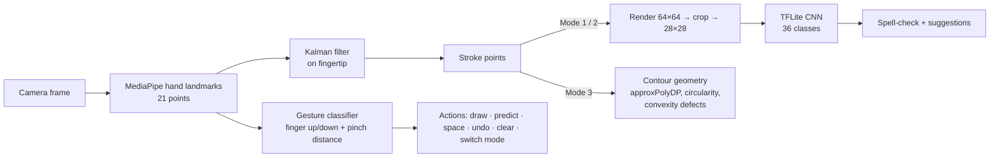

#  Air-Writing Recognition

Write letters, words and shapes **in the air with your finger** — a webcam (or phone camera) tracks your hand, turns the fingertip path into a stroke, and a CNN recognises what you wrote. Gestures replace the keyboard: pinch to confirm, open palm to clear, fist to undo.

The project ships in two forms built on the same pipeline:

| | Desktop (Python) | Android (Java) |
|---|---|---|
| Entry point | `air_writing_final_fixed.py` | `app/` (Android Studio project) |
| Hand tracking | MediaPipe Hands | MediaPipe Tasks `HandLandmarker` |
| Recogniser | TFLite CNN (36 classes) | Same `air_model.tflite` |
| Camera | OpenCV | CameraX |

---

## Features

- **Three modes**
  - **Mode 1 — Character:** draw a single letter or digit (0–9, A–Z) and confirm it.
  - **Mode 2 — Word + autocorrect:** write a word character by character; spelling suggestions update after every character and appear as selectable pills. Next-word suggestions are offered after a word is committed.
  - **Mode 3 — Shape:** recognises circle, ellipse, triangle, square, rectangle, pentagon, hexagon, star, heart, arrow and lines using contour geometry (no ML model needed).
- **Kalman-filtered fingertip tracking** for smooth strokes without jitter.
- **Auto-predict** after 2 s of inactivity, so you don't always need the confirm gesture.
- **Top-3 predictions** with confidence, plus optional **text-to-speech** of the output (desktop).

## How it works



The 28×28 preprocessing in the app matches the training pipeline exactly — stroke rendered on a 64×64 canvas, centre-cropped to its bounding box, resized and normalised to [0, 1].

## Gestures (desktop)

| Gesture | Action |
|---|---|
| ☝️ **Ring finger only** up | Draw (pen down) |
| 🤏 **Pinch** index + thumb (other fingers down) | Predict / confirm character |
| 🤙 **Pinky only** up | Commit word + space (Mode 2) |
| 🖐️ **All five fingers** open | Clear canvas |
| ✊ **Fist**, thumb tucked in | Undo |
| 👍 **Thumb only** up | Clear all text |
| Ring fingertip hovering over **ERASE** | Erase text |
| **Thumb + ring** held 1.2 s | Switch to Mode 1 |
| **Index + middle** held 1.2 s | Switch to Mode 2 |
| **Index + middle + ring** held 1.2 s | Switch to Mode 3 |

Press **q** to quit.

> **Android differences:** the app draws with the **index** finger instead of the ring finger, and switches to Mode 1 with **index + pinky**. All other gestures are the same.

## Getting started

### Desktop

```bash
git clone https://github.com/Vijeta1107/Air-writing-recognition.git
cd Air-writing-recognition
python -m venv venv && source venv/bin/activate   # Windows: venv\Scripts\activate
pip install -r requirements.txt
python air_writing_final_fixed.py
```

A webcam is required. The script uses the trained model bundled in `app/src/main/assets/air_model.tflite` automatically; to use your own, place `air_model.tflite` in the repo root.

### Android

1. Open the repo in **Android Studio** and let Gradle sync.
2. Run the `app` configuration on a device with a front camera (minSdk 24, targetSdk 36).
3. Grant camera permission on first launch.

The TFLite model and MediaPipe `hand_landmarker.task` are already in `app/src/main/assets/`.

## Training your own model

1. **Collect data** — `python data_creation.py` opens the webcam; draw a character in the air, press **Shift + A–Z** to set the label, lowercase **s** to save and **c** to clear. Images are written to `dataset1/<label>/` as 28×28 PNGs. The camera is opened with the Windows `CAP_DSHOW` backend; on macOS/Linux, change `cv2.VideoCapture(0, cv2.CAP_DSHOW)` to `cv2.VideoCapture(0)`.
2. **Train** — zip `dataset1/`, upload it to Google Colab and run `colab_train_script.py`. It trains a CNN with augmentation (rotation, zoom, shift) for 40 epochs and exports `air_model_optimized.tflite`.
3. **Deploy** — rename it to `air_model.tflite` and put it in the repo root (desktop) or `app/src/main/assets/` (Android).

**Model architecture** (input 28×28×1):

```
Conv2D(32, 3×3, ReLU) → BatchNorm → MaxPool(2)
Conv2D(64, 3×3, ReLU) → BatchNorm → MaxPool(2)
Flatten → Dense(128, ReLU) → Dropout(0.4) → Dense(36, softmax)
```

Class order must be sorted folder names (`0`–`9`, then `A`–`Z`) — the desktop app and `TFLiteModel.java` both assume this.

## Project structure

```
├── air_writing_final_fixed.py   # Desktop app: tracking, gestures, 3 modes, UI
├── data_creation.py             # Webcam tool to collect labelled air-writing samples
├── colab_train_script.py        # CNN training + TFLite export (Google Colab)
├── requirements.txt
├── TestMoore.java               # Standalone test of Moore-neighbour contour tracing
└── app/src/main/
    ├── assets/
    │   ├── air_model.tflite         # Trained character recogniser
    │   └── hand_landmarker.task     # MediaPipe hand model
    └── java/com/example/air_wir_rec/
        ├── MainActivity.java        # Camera, landmarks, gestures, modes
        ├── TFLiteModel.java         # Model loading + inference
        ├── ShapeRecognizer.java     # Geometric shape classification
        ├── AutoCorrect.java         # Spelling + next-word suggestions
        ├── DrawingView.java         # Stroke overlay
        ├── CameraView.java
        └── ImageUtils.java
```

## Limitations

- Accuracy depends heavily on how many air-written samples each class has; visually similar pairs such as O/0 and I/1 are inherently hard to separate from a single stroke.
- Recognition is per-character — cursive or joined writing isn't supported.
- Works best with good lighting and a single hand in frame.

## Tech stack

Python · OpenCV · MediaPipe · TensorFlow / TFLite · pyspellchecker · Java · Android CameraX
